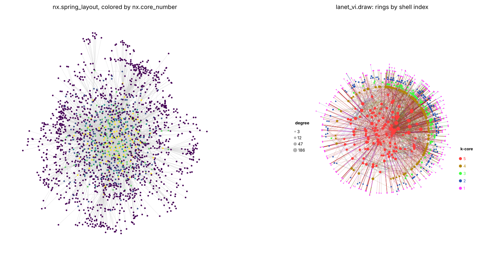

# Using LaNet-vi from NetworkX

LaNet-vi draws any NetworkX graph as it is, with no export step. `lanet_vi.draw(G)` renders
the full LaNet-vi picture on a matplotlib figure (or on axes of your own), and
`lanet_vi.lanetvi_layout(G)` returns only the node positions, the way `nx.spring_layout`
does, for NetworkX's own drawing functions.

## A synthetic Internet, two ways

The example below builds a synthetic Internet topology of 2,000 autonomous systems with
`nx.random_internet_as_graph` and draws it twice on one figure. On the left, NetworkX's
spring layout, with nodes colored by `nx.core_number`. On the right, `lanet_vi.draw`, which
places every node in a ring by its shell index: the densest core sits in the center and
each lower shell surrounds it, so the hierarchy shows at a glance.



The script also checks that LaNet-vi's shells are the k-cores that `nx.core_number` finds.
Run it from a clone of the repository with
`uv run python examples/networkx_example.py`, or copy it after `pip install lanet-vi`.

```python
--8<-- "examples/networkx_example.py"
```

## Only the positions

`lanetvi_layout` works like any NetworkX layout function:

```python
import networkx as nx
import lanet_vi

G = nx.random_internet_as_graph(2000, seed=7)
pos = lanet_vi.lanetvi_layout(G)
nx.draw(G, pos, node_size=5, width=0.3)
```

The [usage guide](usage.md#from-networkx-code) lists what both functions accept, and the
[API reference](api.md#from-networkx) documents every parameter.
